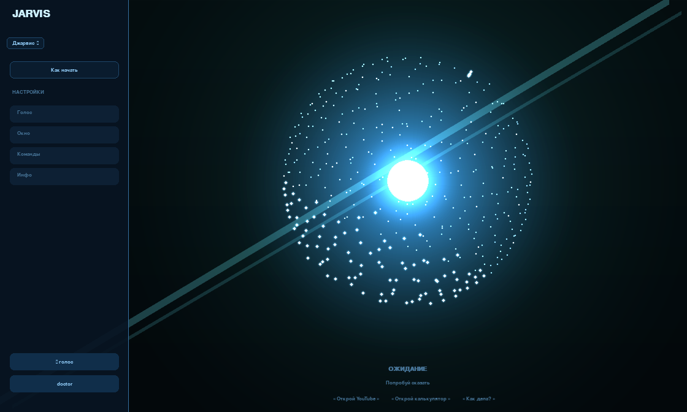

# JARVIS Lite

Сверхлёгкий голосовой ассистент в стиле Джарвиса из «Мстителей». Заточен под
слабое/старое железо (рассчитан на ваш Intel Core i7-2620M @ 2.70 GHz,
2 ядра / 4 потока): вся «тяжёлая» работа нейросетей вынесена в облако,
локально остаётся только тонкий клиент и синтез речи.

## Почему это БЕСПЛАТНО

Четыре варианта, ни один не требует подписку:

1. **Ничего не настраивать** — Джарвис уже работает: у него встроено бесплатное
   облако **Pollinations.ai** (без ключей, без регистрации, без карты). Лимит —
   примерно один ответ в 45 секунд, модель по умолчанию `openai-fast`.
   Просто: `python jarvis.py`
2. **Полностью офлайн через Ollama**. Никакого интернета и никаких ключей:
   [ollama.com](https://ollama.com) + крошечная модель `qwen2.5:0.5b-instruct`
   (около 400 МБ). На старом 2-ядерном процессоре будет медленно (3-10 токенов/сек),
   но бесплатно и безлимитно. Скрипт сам пробует Ollama перед облаком.
3. **OpenRouter**. Бесплатные модели с суффиксом `:free`:

```bash
MISTRAL_API_KEY="ключ_openrouter" \
JARVIS_API_URL="https://openrouter.ai/api/v1/chat/completions" \
JARVIS_MODEL="meta-llama/llama-3.1-8b-instruct:free" \
python3 jarvis.py
```

4. **Mistral API** — по подписке (обновление: бесплатный тариф больше не активирует
   ключи API). Работает, если ключ уже есть. Скрипт пробует его первым только
   когда задан `MISTRAL_API_KEY`.

## Почему это быстро

- **Один файл, ~250 строк, ноль pip-зависимостей** — только стандартная
  библиотека Python.
- **Ответы стримятся потоково**: вывод и озвучка начинаются с первого
  предложения, не дожидаясь полного ответа.
- **TTS — espeak-ng**: крохотный бинарник, не требует GPU и гигабайт моделей,
  отлично держит русский язык даже на процессоре 2011 года.
- **Мгновенные команды** (`время`, `дата`, `статус`, `ты кто`) не тратят
  сетевые запросы и не ждут модель.
- **Кэш ответов**: повторный (даже по-другому написанный) вопрос с чистого
  листа отвечает мгновенно из памяти, без запроса к облаку — полезно из-за
  лимита Pollinations (~1 запрос в 45 секунд). Работает даже если сеть упала.

## Установка

### Windows 10/11

1. Установите Python с [python.org](https://www.python.org/downloads/) — при установке
   обязательно отметьте галочку **Add python.exe to PATH**.
2. Установите espeak-ng — скачайте MSI-установщик со страницы
   [релизов espeak-ng](https://github.com/espeak-ng/espeak-ng/releases)
   (файл вида `espeak-ng-x64.msi`) и просто установите.
3. Откройте командную строку в папке проекта и запустите:

```bat
set MISTRAL_API_KEY=ваш_ключ
python jarvis.py
```

### Linux (Ubuntu/Debian)

```bash
sudo apt install espeak-ng python3
```

## Встроенный движок (без установки руками)

Голос (озвучка + распознавание) ставится одной командой:

```
python jarvis.py setup voice
```

Скачает espeak-ng с GitHub (~13 МБ, тихая установка msiexec), при необходимости
предложит поставить `vosk` и `sounddevice` через pip и произнесёт пробную фразу.

Локальный мозг — как раньше:

Одна команда ставит движок сама:

```bash
python jarvis.py setup
```

Скрипт скачает установщик Ollama (Windows: ~700 МБ), молча установит его, поднимет
сервер и скачает модель `qwen2.5:0.5b-instruct` (~400 МБ). Дальше Jarvis ходит за
ответами к вашему же процессору — без интернета, без ключей и без лимитов.

Если Ollama уже установлена, но сервер не запущен, jarvis.py поднимет его сам при
старте. Если движка нет и вы отказались — Jarvis молча отвечает через бесплатное
облако Pollinations.

## Запуск

Просто запустите — ключ не нужен (бесплатное облако Pollinations встроено):

```bash
python3 jarvis.py            # текстовый режим
python3 jarvis.py voice      # голосовой режим (vosk)
python3 jarvis.py gui        # окно во весь размер: сайдбар слева + шар, настройки — клик по шару
```

## GUI: шар-ядро

 [▶ анимация (GIF)](docs/orb_v13.gif) · [панель настроек](docs/orb_panel_v13.png) · [HUD Iron Man](docs/hud_v14.png)

### HUD Iron Man

Вокруг шара — HUD в стиле интерфейса Старка: три встречно вращающихся
дуговых кольца (голубые + золотые), радиальные чёрточки-тики вокруг ядра,
справа блок данных (время, дата, аптайм, токенов, фактов в памяти, команд)
и живой эквалайзер-волна. При обработке/ответе HUD оживает: тики удлиняются
и часть их подсвечивается золотым. Вкл/выкл — раздел «Окно» →
чекбокс «HUD Iron Man» (сохраняется).

### Голограмма: чат + мини-моделька поверх экрана

Кнопка **«голограмма (hud)»** в сайдбаре (или `python jarvis.py hud`) показывает
маленькую скруглённую панель-голограмму (380×500) поверх всех окон.

**Умное место (v19/v20).** Перед показом и далее каждые ~30 с панель снимает
весь рабочий стол (локально, Pillow `ImageGrab`) и ищет под себя самое пустое
место — не по углам, а по всему экрану: строится «карта пестроты» (градиент
яркости по сетке), и окно панели кладётся туда, где суммарная пестрота
минимальна. Если пустоты под большой размер нет, панель сама сжимается:
380×500 → 380×440 → 320×420 → 300×360, а когда место освобождается — снова
растёт. Частые перезды исключены: место меняется только если новое ощутимо
пустее текущего. Всё локально, миллисекунды, без сети. Если Pillow не
установлен, панель просто встаёт в правый нижний угол; проверка: в `hud.log`
строка `scan экрана недоступен` означает `pip install pillow`.
`hud.log` видно `все углы busy=0` или `scan экрана недоступен` — значит
Pillow не установлен: `pip install pillow` и перезапусти панель.

- **клик по шапке панели** — свернуть до компактного кубика с орбом (110×104); клик по нему — развернуть обратно;
- **Ctrl+Alt+H** — немедленный новый скан и переезд в самое пустое место;
- **✕** — закрыть (или Ctrl+Alt+J).

На Windows панель работает на **tkinter** (родная виндовая отрисовка —
pygame/SDL на части машин отдаёт чёрное окно); откат на pygame-оверлей:
`JARVIS_HUD_BACKEND=pygame python jarvis.py hud`. Диагностика пишется в
`hud.log` рядом с jarvis.py. Для умного размещения желательно
(не обязательно) `pip install pillow`.

На панели:
- **мини-моделька** — маленький вращающийся орб (ускоряется, когда Джарвис думает, золотые точки при ответе);
- **чат с Джарвисом** — кликни в строку внизу панели, введи команду, Enter: ответ приходит через ту же цепь (Ollama → бесплатное облако) и озвучивается;
- горячие клавиши, свои команды и память — всё работает, как в главном окне.

Убрать — **Ctrl+Alt+J**, второй клик по кнопке «голограмма (hud)» в окне JARVIS,
файл `hud.stop` рядом с jarvis.py (или закрыть окно JARVIS).


`python3 jarvis.py gui` — «ядро Джарвиса» (pygame): сферическое облако из ~400
мелких светящихся токенов (сине-белые градиенты + редкие белые искры),
ярко-белое ядро в центре и аура. Шар сам меняет ВИД каждые ~9–15 сек:
равномерное облако точек → широтные кольца → спиральная нить →
«Земной шар» — с плавным перелётом точек. Линии-связи между шарами убраны:
используется чистая «пуантельная» картинка.
Фон — «мятное стекло»: вертикальный градиент, бирюзовое свечение за шаром
и диагональные блики. Плюс живые анимации: волна сверху вниз и обратно при
обращении «Джарвис…», раз в ~30 сек несколько токенов катятся по прямой к
ядру и обратно, скан-волна по одной точке, волна «думаю»,
пульс при ответе и мягкие «дёргания» раз в 4–9 сек. Внизу — статус (СЛУШАЮ / ОБРАБАТЫВАЮ / ГОВОРЮ),
последнее действие («Готово: …»), прогноз следующего действия и кликабельные фразы « Открой YouTube » и др.

### Земной шар в орбе

Четвёртый вид шара строит настоящую Землю по реальным береговым линиям Natural
Earth (компактный датасет встроен прямо в jarvis.py, работает офлайн):
80% токенов выкладывают чёткие контуры континентов — Евразия, Африка,
Северная и Южная Америка, Австралия, Гренландия и крупные острова, ещё 13%
заполняют внутренности материков, 7% — океаны. Берега самые яркие и плотные,
суша средней яркости, океан тусклый — границы континентов читаются как линии
из шаров. Чем больше `JARVIS_ORB_BALLS`, тем мельче шаг контура и точнее Земля.

Слева всегда развёрнут сайдбар (как в лицензионном JARVIS): логотип **JARVIS**, выпадашка
«Джарвис ▾», кнопка **«Как начать»**, разделы **Голос / Окно / Команды / Инфо**, внизу
**🎤 голос** и **doctor**.

Настройки открываются **кликом по шару** — панель разворачивается прямо поверх него и
полностью его закрывает. Разделы сайдбара тоже открывают настройки:

- **Голос** — скорость речи, громкость (ползунки со значениями), город погоды.
- **Окно** — ползунок «токенов в шаре» (вступит после перезапуска), чекбоксы
  «окно поверх всех» и «HUD Iron Man».
- **Команды** — конструктор своих голосовых команд.
- **Инфо** — движок озвучки, мозг (Ollama → облако), память, число команд.

Панель закрывается кнопкой ✕, клавишей Esc или кликом вне панели. Всё сохраняется в `gui_settings.json` (включая число
токенов и «поверх всех») и применяется при следующем запуске.

### Конструктор команд

В разделе «Команды»: впиши фразу (варианты — через запятую), параметр,
выбери тип кликом по кнопке и нажми «добавить»:

- **сайт** — откроет ссылку (например `https://youtube.com`);
- **программа** — запустит приложение (`chrome`, `notepad`);
- **фраза** — просто озвучит текст;
- **команда** — выполнит встроенную команду Джарвиса (например `время`).

Свои команды хранятся в `custom_commands.json` и работают **сразу**, без
перезапуска — и в текстовом, и в голосовом режиме (распознавание неточное:
похожая фраза тоже сработает). Удаление — крести­ком ✕ у строки в списке.

Если pygame ещё не стоит — Джарвис предложит поставить его сам, иначе откроет
простой tkinter-вариант без зависимостей.

Зависимости для GUI: `pip install pygame` (Джарвис предложит сам). Голос — vosk+sounddevice, озвучка — espeak-ng.

| Переменная        | По умолчанию | Что делает                                        |
|-------------------|--------------|---------------------------------------------------|
| `JARVIS_ORB_BALLS`| `400`        | Кол-во «токенов» в шаре (меньше — дешевле CPU)    |
| `JARVIS_ORB_SIZE` | `1120`       | Ширина окна в пикселях (мин. 760)                 |
| `JARVIS_ORB_HEIGHT`| `672`       | Высота окна в пикселях (мин. 560)                 |
| `JARVIS_TOPMOST`  | `0`          | `1` — окно сразу поверх всех                      |

Если появится ключ (Mistral, OpenRouter, любой OpenAI-совместимый) — задайте
`MISTRAL_API_KEY` и скрипт будет использовать его первым:

```bash
MISTRAL_API_KEY="ваш_ключ" python3 jarvis.py
```

## Настройка через переменные окружения

| Переменная        | По умолчанию            | Что делает                                        |
|-------------------|-------------------------|---------------------------------------------------|
| `MISTRAL_API_KEY` | —                       | Ключ Mistral API (облачный режим)                 |
| `JARVIS_MODEL`    | `mistral-small-latest`  | Модель в облаке                                   |
| `JARVIS_MAX_TOKENS` | `300`                 | Ограничение длины ответа (меньше — быстрее)       |
| `JARVIS_VOICE`    | `ru`                    | Голос espeak (например `en` для английского)      |
| `JARVIS_VARIANT`  | —                       | Вариант голоса, напр. `mb-ru2` (нужен mbrola)     |
| `JARVIS_RATE`     | `48`                    | Скорость речи (words/min): меньше — медленнее и разборчивее |
| `JARVIS_PITCH`    | `45`                    | Высота голоса (больше — «моложе»)                 |
| `JARVIS_ADDRESS`  | `сэр`                   | Как Джарвис к вам обращается                      |
| `JARVIS_VOLUME`   | `100`                   | Громкость озвучки (0-200)                         |
| `JARVIS_PLAYER`   | —                       | Свой проигрыватель WAV: шаблон с `{file}` и `{device}` |
| `JARVIS_DEVICE`   | —                       | Устройство вывода для `{device}` в JARVIS_PLAYER  |
| `JARVIS_WAKE_WORDS` | `джарвис,...`         | Слова-активаторы в голосовом режиме (через запятую) |
| `JARVIS_VOSK_MODEL` | автоскачивание        | Путь к своей модели vosk                          |
| `JARVIS_OLLAMA`   | `http://127.0.0.1:11434/api/chat` | Адрес локальной Ollama (запасной режим) |
| `JARVIS_LOCAL_MODEL` | `qwen2.5:0.5b-instruct` | Модель Ollama, если ответ нужен даже без интернета |
| `JARVIS_POLLINATIONS` | `https://text.pollinations.ai/openai` | Бесплатное облако без ключа (крайний фолбэк) |
| `JARVIS_MEMORY`   | `memory.json` рядом с jarvis.py   | Файл постоянной памяти                    |
| `JARVIS_CITY`     | `москва`                | Город погоды по умолчанию                          |
| `JARVIS_POLLINATIONS_MODEL` | `openai-fast` | Модель Pollinations |

## Запасной режим без интернета (Ollama)

Если вдруг облачный API недоступен, Джарвис автоматически переключится на
локальную [Ollama](https://ollama.com). Для старого двухъядерного i7 берите
крошечную модель:

```bash
ollama pull qwen2.5:0.5b-instruct
ollama serve
```

Ожидайте скорость порядка 3–10 токенов/сек без GPU — медленно, но живо.
Облачный режим быстрее на порядки и рекомендуется по умолчанию.

## Диагностика

Если что-то не находится (озвучка, vosk, Ollama) — посмотрите, что видит Джарвис:

```
python jarvis.py doctor
```

Покажет: найдена ли озвучка espeak-ng (включая частые пути Windows вне PATH), установлены
ли vosk/sounddevice, найден ли ollama.exe, поднят ли сервер, скачана ли модель, состояние памяти.

Справка: установщик espeak-ng прописывает себя в PATH только **новым** консолям —
после установки откройте консоль заново.

Если говорит с английским акцентом — у вашего espeak-ng нет русского голоса.
Проверка: `python jarvis.py doctor` покажет строку «русский голос espeak».
Свой голос: `JARVIS_VOICE=ru python jarvis.py voice` (варианты mbrola — через
`JARVIS_VARIANT=mb-ru2`, поставив mbrola).

## Команды

- `запомни: я работаю с 9 до 6` — сохранить факт в постоянную память (`memory.json`,
  переживает перезапуск); факты автоматически подмешиваются в каждый ответ
- `что ты помнишь обо мне` — перечислить сохранённое
- `забудь про Москву` — удалить факты про Москву (падежи понимает), `забудь всё` — стереть память
- `время`, `дата`, `статус`, `ты кто` — мгновенный ответ без запроса к модели
- `открой стим` / `запусти блокнот` / `закрой дискорд` — управление программами
- `открой параметры` / `открой настройки` — открывает Параметры Windows (ms-settings:), а также `открой студию` — VS Code, `открой фотошоп`, `открой ворд`, `открой эксель`
  (транслит чинится автоматически: стим→steam, хрум→chrome, дискорт→discord)
- `найди погоду в москве` / `найди на ютубе котиков` — поиск в браузере
- `открой ютуб` / `открой ютуб музыку` / `открой вк` — сайты одной фразой
- `погода` / `погода в казани` — погода через бесплатный open-meteo (без ключа;
  город по умолчанию настраивается `JARVIS_CITY`)
- **Прогноз действий** — Джарвис запоминает, что вы делаете регулярно (`usage.json`,
  до 400 последних команд). После каждого действия он предугадывает следующее:
  в текстовом режиме печатает `[ прогноз: «открой ютуб» (часто идёт после …) — «да», чтобы выполнить ]`,
  в GUI подставляет светящийся чип `« Да — … »` и строку статуса. Ответьте `да`
  (или `ага`/`ок`/`го`) — и действие выполнится
- `напомни через 20 минут позвонить маме` / `напомни через полчаса перерыв` /
  `напомни в 15:30 выключить плиту` — напоминание прозвучит голосом,
  `какие напоминания` — список активных
- `дай доклад` — время, погода, нагрузка ЦП, память и напоминания одной фразой
- `громкость` | `громкость 50` | `громче` | `тише` — громкость Джарвиса (0-200)
- `выход` / `exit` — завершить разговор

### Системные команды (из первой версии, Windows)

Комбинации клавиш через api `keybd_event` — работают и текстом, и голосом:

| Говорите | Что делает |
|---|---|
| новая вкладка / закрой вкладку | Ctrl+T / Ctrl+W |
| верни вкладку | Ctrl+Shift+T (восстановление) |
| следующая вкладка / предыдущая вкладка | Ctrl+Tab / Ctrl+Shift+Tab |
| обнови страницу | F5 |
| открой историю / открой загрузки (браузера) | Ctrl+H / Ctrl+J |
| инкогнито | Ctrl+Shift+N |
| прибавь звук / убавь звук | громкость системы ×5 |
| выключи звук | режим без звука |
| поставь на паузу / включи музыку | медиа play/pause |
| следующий трек / предыдущий трек | медиа-кнопки |
| сверни все окна | Win+D |
| разверни окна | Win+Shift+M |
| закрой окно | Alt+F4 |
| переключи окно | Alt+Tab |
| на весь экран / фулскрин | F11 |
| скриншот | Win+PrtScr |
| заблокируй | Win+L (блокировка системы) |
| что открыто | список открытых окон |

На Linux эти комбинации аккуратно отвечают, что доступны только в Windows;
список окон, если установлен `wmctrl`, показывается и там.

## Голосовой режим (vosk)

С распознаванием речи с микрофона и активатором «джарвис»:

```bash
pip install vosk sounddevice
python jarvis.py voice
```

При первом запуске автоматически скачается русская модель vosk (~45 МБ) в папку
`models/`. Дальше говорите в микрофон: **«джарвис, открой стим»**, **«джарвис,
который час»**, **«джарвис, громче»**, **«джарвис, найди погоду»** — на вопросы
без действий отвечает LLM и озвучивает ответ по предложениям.

Улучшенное распознавание имён программ встроено: русская модель vosk не знает
латиницу, поэтому русские произношения («стим», «хром», «майнкрафт», «дискорд»,
«телеграм», «роблокс», «ютуб», «гитхаб»…) автоматически переводятся в реальные
английские названия с нечётким сопоставлением опечаток распознавания.
Добавить свои — в словарь `TRANSLIT` в начале jarvis.py.

- Своё слово-активатор: `JARVIS_WAKE_WORDS="джарвис,эрвин"` (через запятую)
- Своя/скачанная модель: `JARVIS_VOSK_MODEL="/путь/к/папке/модели`

## Выбор устройства вывода

По умолчанию espeak-ng играет на устройство по умолчанию. Чтобы выбрать конкретный
выход (наушники, HDMI, USB-колонка), используйте свой проигрыватель:

**Linux (ALSA):**
```bash
sudo apt install alsa-utils
aplay -l                                # посмотреть список устройств
JARVIS_PLAYER="aplay -D {device} {file}" \
JARVIS_DEVICE="plughw:0,0" \
python3 jarvis.py
```

**Linux (PulseAudio/PipeWire):**
```bash
pactl list short sinks                  # список выходов
JARVIS_PLAYER="paplay --device={device} {file}" \
JARVIS_DEVICE="alsa_output.pci-0000_00_1b.0.analog-stereo" \
python3 jarvis.py
```

**Windows:** без JARVIS_PLAYER звук играет на устройство Windows по умолчанию
(меняется правой кнопкой по иконке звука в трее → «Параметры звука»).
Громкость при этом управляется командами `громче`/`тише`/`громкость N` внутри Джарвиса.

## Советы для старых машин

- Уменьшите `JARVIS_MAX_TOKENS` до 150–200: короче ответ — быстрее озвучка.
- Скорость речи настраивается `JARVIS_RATE`: меньше (40–60) — медленнее и разборчивее,
  больше (100+) — быстрее.
- Лучший голос даёт связка espeak-ng + mbrola: установите `mbrola`, загрузите
  русский голос `ru2` из [MBROLA-voices](https://github.com/numediart/MBROLA-voices)
  в `/usr/share/mbrola/ru2/`, затем запустите с `JARVIS_VARIANT=mb-ru2`.
